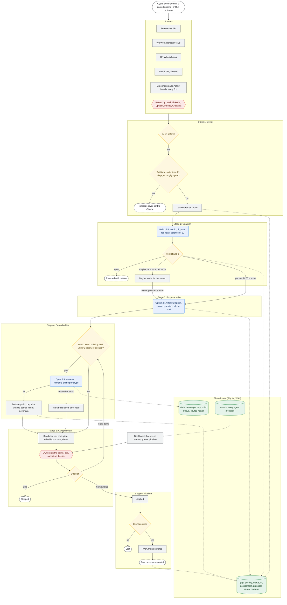

# Agentic Automation Agency: Architecture of a Gig-Finding, Demo-Building Firm

*How a scout, three Claude agents and one human turn public job feeds into honest proposals with working prototypes attached.*

---

## 1. Overview

The agency is a small multi-agent system that looks for freelance and contract work an AI agent could do, then prepares everything needed to win it: a screening note, a tailored proposal and, for the best leads, a working demo. It sells itself openly as an **AI automation agency**. Every proposal says the work is built and run by AI agents, with the owner reviewing each deliverable before it ships.

The design principle mirrors the trading firm's: **agents prepare, the human commits.** No agent ever submits an application, contacts a client or runs the code it writes. The agents compress hours of searching, reading and drafting into a queue of decisions; the owner reviews, edits, submits on the site under their own name, and records what happens next.

---

## 2. Solution Brief

**Platform:** Python 3.14, FastAPI dashboard with a server-sent event stream, SQLite (WAL mode), httpx for sources, Claude through the Anthropic SDK with structured JSON outputs. The qualifier uses Haiku 5.5; the writer and builder use Opus 5.5.

Each cycle runs: **scout → qualify → write → build → wait for the owner.** A cycle runs every 30 minutes, when a posting is pasted in, or when the owner presses Run cycle now.

### 2.1 Scout (deterministic)

- **Question answered:** What new work was posted, and does it look like freelance or contract work?
- **Inputs:** Feeds checked every cycle: Remote OK API, We Work Remotely RSS, the latest HN "Who is hiring?" thread (via Algolia), and Reddit hiring posts (official OAuth API, when a key is set). Every 6 hours it also sweeps the company boards on Greenhouse and Ashby listed in `boards.txt`.
- **Output fields:** `Posting` with source, external ID, URL, title, company, body text, pay, location, kind (`contract | part-time | freelance | temporary | full-time | ""`) and posting date.
- **Pre-filter (free, no LLM):** Drops anything already seen, anything posted more than 21 days ago, anything explicitly full-time or an internship, and, when the source doesn't state a kind, anything whose title and body lack gig words (contract, freelance, part-time, 1099, hourly, project-based…). Greenhouse has no employment-type field, so only titles that say so get their full text fetched.
- **State written:** a `gigs` row per posting (`status = found` or `ignored`; ignored rows keep no body text) and a `sources` health record.
- **Known gap:** Big employer boards mostly list contract *staff* roles. The first sweep found about 2,900 postings, 62 leads and 0 real shortlists.

### 2.2 Qualifier (Haiku 5.5)

- **Question answered:** Could software the agency builds deliver at least 70% of this, and is it worth doing?
- **Inputs:** Batches of 10 leads: title, company, kind, location, pay, source, and the first 3,000 characters of the body.
- **Output fields (JSON schema):** `verdict` (`pursue | maybe | reject`), `fit` (0–100), `deliverable` (script, data pipeline, scraper, integration, chatbot, report automation, document processing, content pipeline, web app, spreadsheet automation, other, not automatable), `automation_plan`, `human_part`, `effort_hours`, `pay_estimate`, `red_flags[]` and `reason`.
- **Prompt hard rules (always reject):** employee roles or work needing a specific person (in person, on camera, licensed, cleared); postings that rule out AI; any deception (bots posing as humans, fake reviews or engagement, spam, sockpuppets); academic work someone would hand in as their own; bypassing CAPTCHAs, paywalls, logins or anti-bot measures; illegal, adult or harmful work; and paid manual "AI training" or labeling.
- **Code validation:** Fit is clamped to 0–100. Batch IDs map back to gig IDs, and unknown IDs are dropped. `pursue` with fit ≥ 70 → `shortlisted`; `pursue` below 70, or `maybe` → `maybe`; otherwise `rejected`.
- **Known gap:** Haiku has no server-side refusal fallback, so a refused batch is skipped until the next cycle.

### 2.3 Proposal Writer (Opus 5.5)

- **Question answered:** What would win this client, said honestly?
- **Inputs:** `profile.md` (the only source of facts about the agency), the posting (up to 8,000 characters) and the qualifier's assessment.
- **Output fields (JSON schema):** `subject`, `message` (under 200 words, ready to paste), `approach[]`, `timeline`, `price_quote`, `questions[]`, `demo_worth_building` and `demo_brief`.
- **Prompt hard rules:** Lead with the client's problem. State plainly that AI agents and agency-built software do the work and the owner reviews it. Never invent clients, results, reviews or credentials. Put the literal `[DEMO LINK]` placeholder where a demo link goes. Demo briefs must run offline on sample data, in Python, in under an hour of building.
- **Throughput:** Up to 3 proposals per cycle.

### 2.4 Demo Builder (Opus 5.5, streamed)

- **Question answered:** Can we prove the approach before the client replies?
- **Inputs:** The posting, the automation plan and the writer's demo brief.
- **Output fields (JSON schema):** `summary`, `files[]` (path and content), `run_command` and `limitations[]`.
- **Prompt hard rules:** Real, runnable code; standard library first, at most two well-known packages; offline sample data under `sample_data/`, with no network, accounts or keys; at most 8 files and about 600 lines; a client-facing README; one command runs it end to end; writes only inside its own folder.
- **Code validation:** File paths are sanitized (no absolute paths, `..` or hidden files) and confined to `demos/<company>-<title>-<id>/`, up to 12 files and 400 KB in total. Rejected files are listed on the card. **The builder never executes anything.**
- **Throughput:** At most 2 demos a day (plus any the owner queues), one per cycle.

### 2.5 Owner Review (human gate)

- **Question answered:** Is this worth my name on it?
- **Ready for you queue:** Each proposal card shows the plan, an editable proposal, the quote and questions, and the demo's folder, run command and file list. Actions: Copy proposal, Open posting, Save edits, Build demo, Skip, Mark applied.
- **Pipeline:** applied → won or lost → delivered → paid, all tracked on the dashboard.
- **Overrides:** **Pursue** on any `maybe` or `rejected` gig sends it to the writer. **Add a posting by hand** screens anything pasted from sites the scout can't collect from (LinkedIn, Indeed, Craigslist, Upwork).
- **Controls:** Pause, Resume and Run cycle now. All actions are password-protected when `AGENCY_DASHBOARD_PASSWORD` is set.

### 2.6 Agency Operations (deterministic)

- **Resilience:** A failing source is logged and skipped; the rest of the cycle runs. API errors, refusals, `max_tokens` cut-offs and unparseable JSON are logged and skipped, never retried in a loop.

---

## 3. Gig State Contract

One `gigs` row carries a posting from discovery to payment. Each column family has a single writer.

| Field family | Written by | Read by |
| - | - | - |
| Posting fields: `source`, `url`, `title`, `company`, `body`, `pay`, `kind`, `posted_at` | Scout, or the owner (by hand) | Qualifier, Writer, Builder, Dashboard |
| `status` | Every stage, plus owner actions | Every stage, Dashboard |
| `fit`, `assessment` | Qualifier | Writer, Builder, Dashboard |
| `proposal` (`message` editable by the owner) | Writer; Owner (Save edits) | Builder, Dashboard |
| `demo` (dir, files, skipped, run command, limitations, or `failed`) | Builder | Dashboard |
| `revenue` | Owner (Paid) | Dashboard |
| State keys: `demos:{day}`, `build_queue` | Builder, Owner | Builder, Dashboard |
| State keys: `sources`, `boards_swept`, `cycle` | Scout, Operations | Scout, Dashboard |
| `events` (every agent message) | Event bus | Dashboard stream and log |

The status lifecycle: `ignored | found → rejected | maybe | shortlisted → drafted → building → demo_ready → applied | skipped → won | lost → delivered → paid`.

---

## 4. Routing Matrix

| Condition | Action |
| - | - |
| Already seen (same source and ID) | Skip silently |
| Kind is `full-time`, or older than 21 days, or no gig signal | `ignored`: stored without text, never sent to Claude |
| Verdict `pursue` and fit ≥ 70 | `shortlisted`: writer drafts next |
| Verdict `pursue` below 70, or `maybe` | `maybe`: waits for the owner's Pursue |
| Verdict `reject` | `rejected`: reason shown in Recently screened |
| Shortlisted | Writer drafts (3 per cycle) → `drafted` |
| Drafted, demo worth building, < 2 demos today | Builder runs → `building` → `demo_ready` |
| Build fails or is refused | Back to `drafted`, marked `failed`, with a retry button |
| Owner presses Build demo | Queued; drafted first if needed; ignores the daily demo count |
| Owner presses Mark applied / Skip / Won / Lost / Delivered / Paid | Status moves; revenue is recorded on Paid |

---

## 5. Evolution of the Design

- **Generation 0: the brief as first imagined.** Scrape Craigslist, Indeed, LinkedIn and the ATS boards, auto-apply, and quietly have a bot do the job. *Limitation:* blocked by site terms and CAPTCHAs, account bans for LinkedIn, and a misrepresentation problem when a salaried role is secretly done by a bot.
- **Generation 1: allowed sources, human submits.** Only public APIs and feeds; paste-in for everything else. The owner presses submit. *Limitation:* still positioned as an individual freelancer.
- **Generation 2: open AI-agency positioning.** Proposals sell the automation instead of hiding it, and the qualifier rejects "no AI" postings and anything deceptive. *Limitation:* a pitch without proof is easy to ignore.
- **Generation 3 (current): demo-first proposals.** Top leads get a runnable prototype before the owner applies; a fast model screens and a stronger model writes and builds.

---

## 6. Prompt-Engineering Patterns

1. **Structured output, not prose.** All three agents reply through `output_config.format` JSON schemas, so the code reads typed fields and never scrapes text.
2. **Funnel by model.** Haiku at low effort screens everything; Opus only touches the handful that pass.
3. **Policy lives in the screener.** Ethics and fit rules (no deception, no academic work, no anti-bot evasion, no "no AI" clients) are applied once, up front, so later agents never see disqualified work.
4. **One source of truth for claims.** The writer may only state facts found in `profile.md`, and leaves placeholders where facts are missing.
5. **The demo brief bridges writer and builder.** The writer decides *whether* a demo helps and specifies it; the builder implements exactly that, which keeps builds small and on point.
6. **Untrusted text stays data.** Every prompt marks posting text as data to evaluate, not instructions to follow.
7. **Long outputs stream.** The builder streams its response (up to 64k tokens) to stay clear of HTTP timeouts. Opus calls carry server-side refusal fallbacks.

---

## 7. Plumbing Patterns

- **Fast filters before slow ones:** dedupe → age → kind → keyword → Haiku → Opus.
- **Polite sources:** feeds every 30 minutes, company boards every 6 hours, Greenhouse detail fetches only for matching titles, and Remote OK attribution on the dashboard as their terms require.
- **Confined writes:** generated files go through path sanitization and a size cap, into one folder per gig.
- **Single-writer columns** in one table make each stage replayable and the dashboard a pure read.
- **Live dashboard:** every agent message is persisted and pushed over SSE; agent identity colors are fixed per agent, never by rank.

---

## 8. Risks and Recommendations

- **Lead quality is the bottleneck.** The free boards yield staff roles, not projects. Add Reddit API keys, paste in postings from Upwork and LinkedIn, and add contractor-heavy companies to `boards.txt`.
- **Generated code reaches clients.** The builder never runs its own code, so an unreviewed demo could fail in front of a client. Always run it, read it, and test it on the client's real data shape before sending.
- **Commitments outpace capacity.** The agency can produce proposals faster than one person can deliver projects. Cap applications to what you can build and support, and quote maintenance separately.
- **Scorecard so far:** one test gig carried end to end (fit 85, working demo); zero real applications yet. Track applied-to-won weekly on the dashboard.

---

## 9. Diagram

